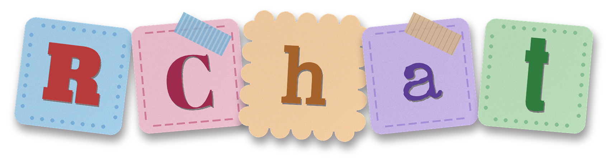
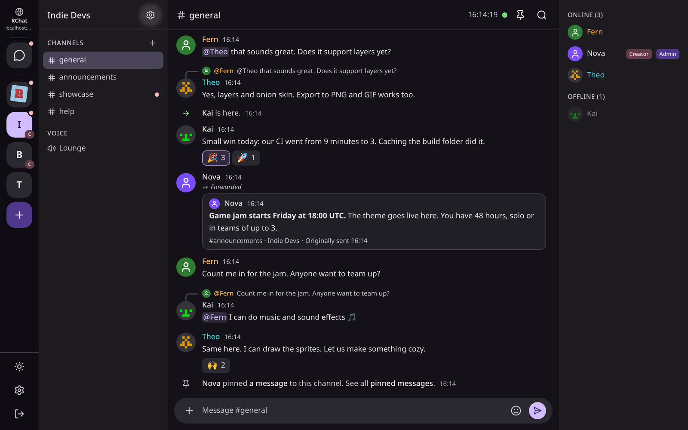
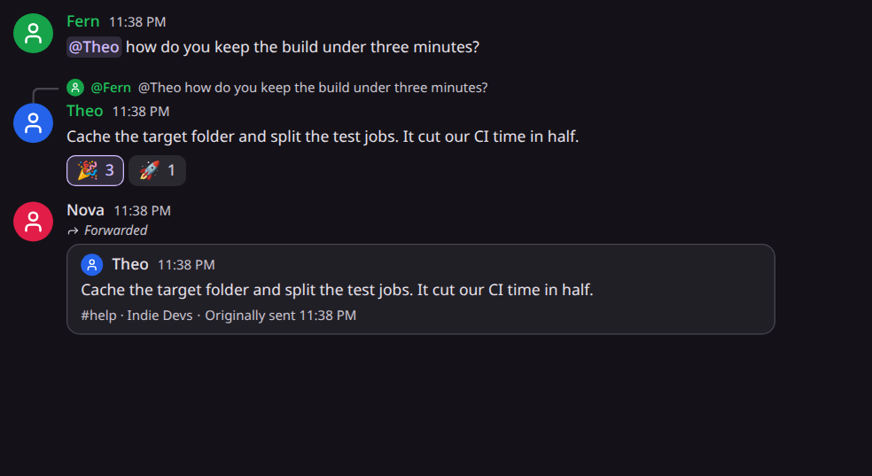
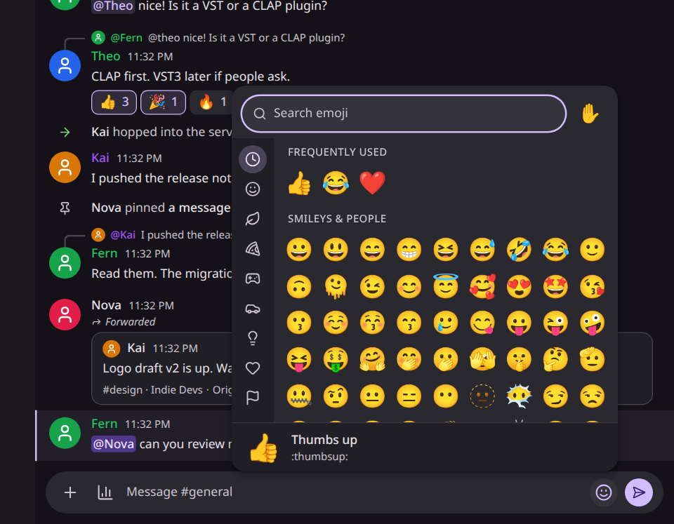
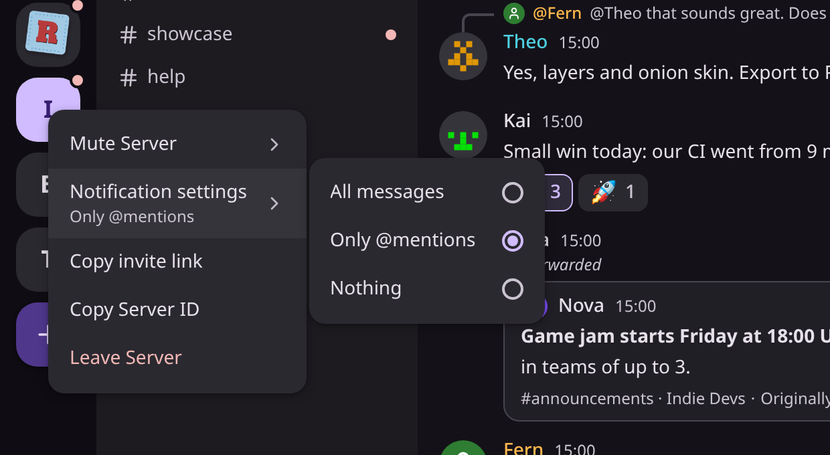
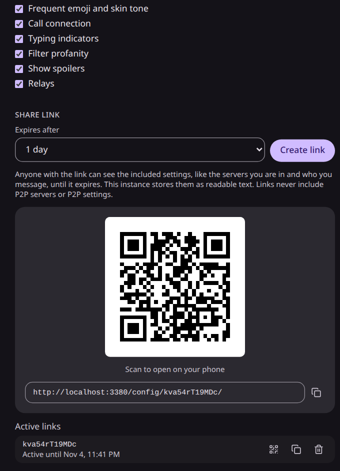
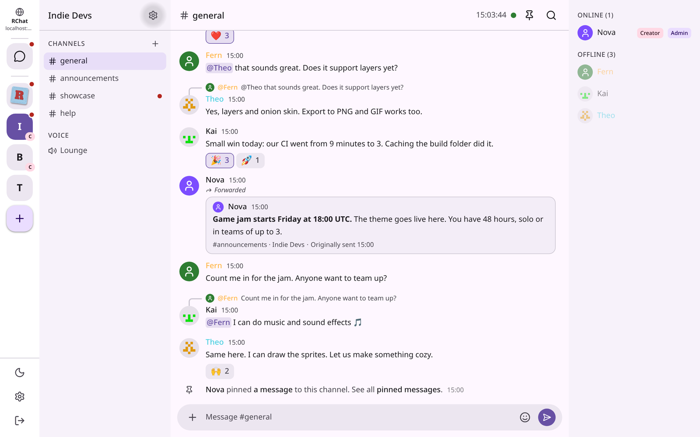
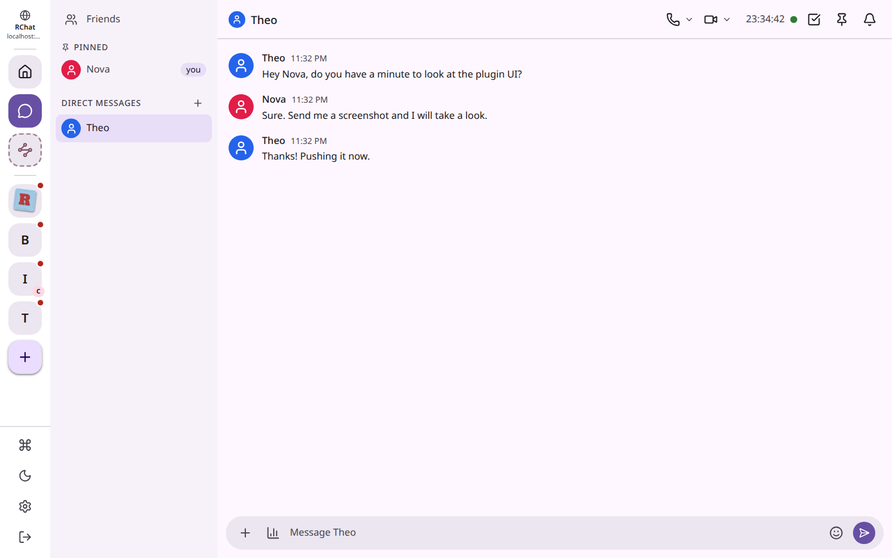
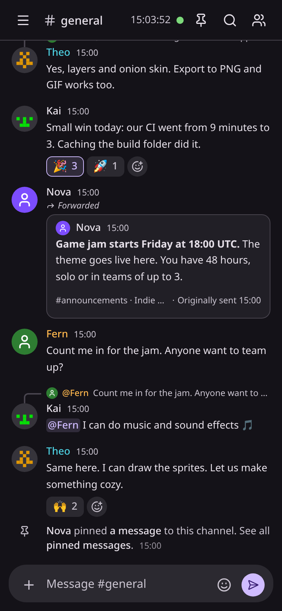
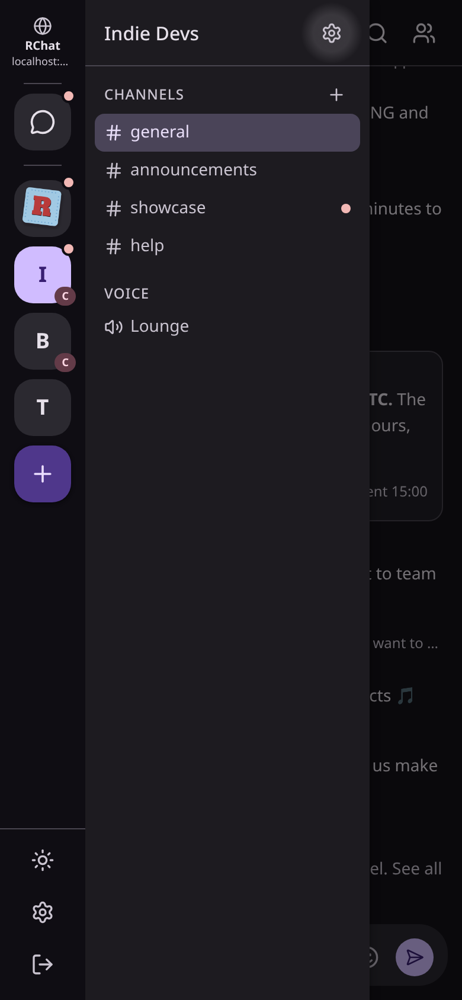

<p align="center">
  
</p>

<p align="center">
  <a href="https://github.com/RobbyV2/RChat/actions/workflows/ci.yml"></a>
  <a href="https://github.com/RobbyV2/RChat/pkgs/container/rchat"></a>
  
  
  
  
</p>

# RChat

RChat is an anonymous chat app with a layout like Discord. It runs on your own machine. It uses no external services, no email and no tracking.

<p align="center">
  
</p>

Browsers: current Chrome, Edge and Firefox. Safari and iOS need version 16.4 or newer.

## Features

| Feature                | What it does                                                                                                          |
| ---------------------- | --------------------------------------------------------------------------------------------------------------------- |
| Servers and channels   | Make servers with text channels, voice channels and threads.                                                          |
| Roles                  | Give members roles with a color and permissions. A member cannot give more permissions than they have.                |
| Voice, video and share | Talk in voice channels. Turn on your camera or share your screen.                                                     |
| Direct messages        | Send private messages. Start voice or video calls in a DM. Close a DM to hide it until the next message.              |
| P2P calls              | Call over a direct link between browsers.                                                                             |
| P2P attachments        | Send files of any size from your browser. The server stores only the name, size and hash. Works when uploads are off. |
| Relay servers          | Help calls and P2P files connect through STUN and TURN. Off by default. Relay only hides your IP address.             |
| Your own relays        | Add your own STUN and TURN relays for P2P files and calls. You are asked before using someone else's unknown relay.   |
| Uploads                | Upload files and images up to 25 MB. The server deletes them after one day. The site admin can turn them off.         |
| Text only mode         | Turn off uploads and P2P attachments. Then messages can contain only text and emoji.                                  |
| Link previews          | Show a card for links in a message. The server gets the preview and its image, not your browser.                      |
| Mentions               | Type `@name` to ping a person. The app highlights messages that mention you.                                          |
| Reactions              | React to a message with an emoji. Your own reactions show in blue.                                                    |
| Emoji picker           | Search emoji by name. The picker keeps your frequent emoji and skin tone.                                             |
| Replies                | Reply to a message. You can choose to ping the author or not.                                                         |
| Edit messages          | Edit your message. Type `s/old/new` to fix your last message quickly.                                                 |
| Forwarding             | Forward a message to a different channel or DM. Open a public server as a preview before you join.                    |
| Pins                   | Pin important messages. Open all pins from the channel header.                                                        |
| Join and leave notices | Show a notice when a member joins or leaves. Server admins choose the channel or turn notices off.                    |
| Restricted channels    | Let only some roles or members see a channel or send in it.                                                           |
| Channel topics         | Add a topic to a text or voice channel. It shows at the top of the channel.                                           |
| Channel categories     | Group text and voice channels into categories. Managers drag channels and categories to reorder them.                 |
| Slow mode              | Set a wait time between messages in a channel.                                                                        |
| Server passwords       | Use a permanent password, temporary passwords or tickets with a use limit. Close the server to new members.           |
| Private servers        | A server with a password stays hidden from people who are not members.                                                |
| Invite links           | Paste an invite link to show a join card. Open it to see a full invite page.                                          |
| Mini profiles          | Click a name to see roles, bio, join dates and a quick DM box.                                                        |
| Moderation             | Kick and ban members. The site admin can delete users, servers and messages.                                          |
| Blocking               | Block a person. They cannot DM, call or ping you, and their messages are hidden. Manage the list in Settings.         |
| Friends                | Send, accept and deny friend requests and see who is online. Limit DMs and friend requests in Settings.               |
| Polls                  | Single, multiple and ranked choice, rating scales and yes/no. Anonymous or public, deadlines, live results.           |
| Message selection      | Select messages with Shift and Ctrl clicks or all at once. Delete, copy, pin, forward or export them together.        |
| Notifications          | Choose all messages, mentions only or nothing per server or channel. Mute for a time. Get desktop alerts.             |
| Organize               | Drag servers and DMs into your order. Drop a server on another to make a folder. Pin DMs.                             |
| Search                 | Search messages with date filters. Search for servers by name.                                                        |
| Command palette        | Press Ctrl+K to go anywhere, run any action, search a local index or try the API with forms.                          |
| Sync config            | Export your settings and layout as text, a file, a share link or a QR code. Import them on a different device.        |
| Appear offline         | Hide your online status from other people.                                                                            |
| Streamer mode          | Blur names on screen while you stream. Hover to show a name.                                                          |
| Guests                 | Read public servers without an account. Guests cannot send messages.                                                  |
| Accounts               | Sign in with a text password or with 7 words in order. No email and no phone number.                                  |
| Themes                 | Use the dark or the light theme. Install the app as a PWA.                                                            |
| Profanity filter       | The site admin turns the filter on or off for messages, names, file names, bios and topics.                           |
| Multiple instances     | Each instance has its own name and identity. The login page lets you pick a different instance.                       |

<p align="center">
  
  
</p>
<p align="center">
  
  
</p>
<p align="center">
  
</p>
<p align="center">
  
</p>
<p align="center">
  
  
</p>

## Setup

You need Rust, Bun, wasm-pack and [just](https://github.com/casey/just).

Copy the example settings:

```bash
cp .env.local.example .env.local
```

Install the dependencies:

```bash
just src install
```

Start the app:

```bash
just src dev
```

Open http://localhost:3000. The first account you register is the site admin. Nobody else can see this.

## Layout

| Path           | What it is                                             |
| -------------- | ------------------------------------------------------ |
| `apps/web`     | The Next.js client (a Bun workspace).                  |
| `apps/server`  | The Rust server (a Cargo workspace member).            |
| `apps/desktop` | The Tauri app (Windows, macOS, Linux, Android, iOS).   |
| `crates/wasm`  | The WASM module for the client.                        |
| `assets`       | Logos, fonts and the bundled STUN list.                |
| `deploy`       | Compose, Kubernetes and nginx files.                   |
| `packaging`    | Package manager templates (see Releases).              |
| `scripts`      | Release scripts for CI.                                |
| `jfiles`       | The `just` recipes. Run them from the repository root. |

Keep `.env.local` in the repository root. The root scripts and `just` recipes read it from there.

## Deployment modes

Run everything in one process (the default):

```bash
just src prod
```

Run only the API:

```bash
APP_MODE=api-only just src api
```

Build the frontend as static files for that API. The files go to `apps/web/out/`:

```bash
just src build-static https://api.example.com
```

Run the Docker image. `latest` is the newest stable release, `weekly` the newest weekly build:

```bash
docker run -p 3000:3000 -v rchat-data:/data ghcr.io/robbyv2/rchat:latest
```

The image runs as user 10001. A volume made by an image before 0.3.0 belongs to root; give it to that user once:

```bash
docker run --rm -u 0 -v rchat-data:/data --entrypoint chown ghcr.io/robbyv2/rchat:latest -R 10001:10001 /data
```

Build the image locally with `docker compose up`.

## Desktop app

`apps/desktop` is a Tauri 2 shell for Windows, macOS and Linux. It bundles the static client and connects to the instance you pick on first start, like the web app does. It adds system notifications, an unread badge, a tray, deep links, start on login and updates.

You need the Tauri CLI, the wasm-bindgen CLI pinned in `Cargo.lock` and the [Tauri system dependencies](https://tauri.app/start/prerequisites/) for your OS. On Linux these are webkit2gtk 4.1, libsoup 3 and libayatana-appindicator.

```bash
cargo install tauri-cli --version "^2" --locked
cargo install wasm-bindgen-cli --version 0.2.129 --locked
```

Run it against the Next dev server, with hot reload:

```bash
just src desktop
```

Build the installers for your OS. They go to `target/release/bundle/` (.deb, .rpm and AppImage on Linux, NSIS and MSI on Windows, .app and .dmg on macOS):

```bash
just src desktop-build
```

Run the Linux smoke test against a running instance. It needs `xvfb-run` or KDE's `kwin_wayland`:

```bash
apps/desktop/scripts/smoke.sh http://localhost:3000
```

`rchat://chat.example.com/invite/lobby/` opens `/invite/lobby/` on that instance. Any client path works, such as channels, DMs and config links. Hosts like `localhost:3000` use http, all others https.

The content security policy only runs the app's own scripts. The app may connect to any https and wss address, and to http and ws on `localhost` and `127.0.0.1`. To lock a build to fixed instances, write the narrower sources to a file and pass it at build time. Keys you leave out keep their values:

```json
{
  "app": {
    "security": {
      "csp": {
        "connect-src": "'self' ipc: http://ipc.localhost https://chat.example.com wss://chat.example.com",
        "img-src": "'self' data: blob: https://chat.example.com",
        "media-src": "'self' data: blob: mediastream: https://chat.example.com"
      }
    }
  }
}
```

```bash
just src desktop-build --config /path/to/csp.json
```

Updates come from GitHub Releases. The app checks when you ask in Settings, or at start if you turn that on. Builds with `RCHAT_CHANNEL=weekly` follow the weekly channel by default. Update files must be signed:

1. Make a key pair once with `cargo tauri signer generate -w ~/.tauri/rchat.key`. Never commit the private key.
2. Put the public key in `apps/desktop/src-tauri/tauri.conf.json` under `plugins.updater.pubkey`.
3. Give the build the private key and its password in `TAURI_SIGNING_PRIVATE_KEY` and `TAURI_SIGNING_PRIVATE_KEY_PASSWORD`, then run `just src desktop-build --config tauri.release.conf.json` to write the signed update files.

The release workflow does steps 2 and 3 itself when the key is in the repository secrets and the public key is in the `TAURI_UPDATER_PUBKEY` repository variable (see Releases).

## Mobile apps

The Android and iOS apps come from the same Tauri shell as the desktop app. They bundle the static client and add system notifications, the share sheet, deep links and the Android back button. Push notifications are not part of the apps; notices arrive while the app is running.

Android needs the [Android SDK and NDK](https://tauri.app/start/prerequisites/#android) with `ANDROID_HOME` and `NDK_HOME` set. iOS needs macOS with Xcode, CocoaPods and xcodegen. Add the Rust targets once:

```bash
rustup target add aarch64-linux-android armv7-linux-androideabi x86_64-linux-android
rustup target add aarch64-apple-ios aarch64-apple-ios-sim
```

The native projects in `apps/desktop/src-tauri/gen` are generated, not committed. `mobile-init` creates one and applies the files in `apps/desktop/mobile`: icons, splash, call permissions and the Android window insets. Run it again after changing them:

```bash
just src mobile-init android
just src android-build
just src mobile-init ios
just src ios-build
```

CI builds a debug APK and an unsigned iOS build on every push to main and keeps them as run artifacts. Releases carry a signed APK (see Releases).

`rchat://` links open the app like on the desktop. To open `https://` links to your own instance in the app, replace `chat.example.com` in `apps/desktop/mobile/applinks.conf.json`, pass it with `--config` when you build, and serve the two files in `apps/desktop/mobile/well-known` from `https://<your instance>/.well-known/` with your signing certificate fingerprint and Apple team ID filled in.

## Releases

GitHub Actions has two channels:

- Stable: pushing a version tag (`0.3.0`, or `0.3.0-rc.1` for a pre-release; no `v` prefix) publishes a GitHub Release. Pre-releases get no package manager files.
- Weekly: every Monday, `main` is built as a pre-release named `weekly-YYYY-MM-DD` with version `<next patch>-weekly.YYYYMMDD`. The `weekly` and `nightly` tags move to it, and dated weekly releases beyond the newest 8 are deleted. It is skipped when nothing changed. Run the `release` workflow by hand to build one now.

| Workflow      | When                               | What                                                                 |
| ------------- | ---------------------------------- | -------------------------------------------------------------------- |
| `ci.yml`      | Every push and pull request        | Format, Clippy, Rust tests, ESLint, unit tests, web and server build |
| `ci.yml`      | Every push and pull request        | Clippy and tests of the desktop crates (no bundling)                 |
| `ci.yml`      | Pushes to main, manual runs        | Also desktop builds, desktop smoke run, mobile builds, Docker build  |
| `release.yml` | Version tags, Mondays, manual runs | All of the above, then the release                                   |

To skip heavy parts of `ci.yml` on a push, put a tag in the commit message, or give the pull request the label of the same words without brackets. Version tags, the weekly schedule and manual runs ignore them.

| Tag              | Skips                                    |
| ---------------- | ---------------------------------------- |
| `[skip desktop]` | Desktop builds and the desktop smoke run |
| `[skip mobile]`  | Android and iOS builds                   |
| `[skip docker]`  | The Docker build                         |
| `[skip e2e]`     | The desktop smoke run                    |
| `[skip native]`  | Desktop and mobile                       |
| `[ci light]`     | Everything except the fast checks        |

A release holds:

- Windows: MSI and NSIS installers. macOS: a universal DMG. Linux: .deb, .rpm and AppImage (when it builds). Weekly and `-rc` versions get no .rpm. Going from a weekly .deb back to the stable one of the same version needs `apt install --allow-downgrades`.
- Android: an APK, plus an AAB when the release key is set. iOS: an IPA, only when the signing secrets are set.
- Server binaries (`rchat-server`) for Linux x86_64 and aarch64 (glibc 2.35 or newer), macOS (universal) and Windows x86_64. The aarch64 server and Docker builds use GitHub's `ubuntu-22.04-arm` runner.
- `SHA256SUMS`, the updater manifest `latest.json` with `.sig` files when updater signing is set, and `rchat-packaging_<version>.tar.gz`.
- Docker images on GHCR: `latest` and the version for stable, `weekly`, `nightly` and `weekly-YYYY-MM-DD` for weekly, plus the commit SHA.

Signing uses repository secrets when they exist. Without them the builds are unsigned: Windows shows SmartScreen, macOS asks you to allow the app under System Settings, Privacy & Security, and the Android APK uses a key made for that build, so it cannot update an older install. A stable release needs the updater key (`TAURI_SIGNING_PRIVATE_KEY` and the `TAURI_UPDATER_PUBKEY` variable) and fails without it; weekly builds without it ship no updater files.

| Secret or variable                                                                                                            | Used for                        |
| ----------------------------------------------------------------------------------------------------------------------------- | ------------------------------- |
| `TAURI_SIGNING_PRIVATE_KEY`, `TAURI_SIGNING_PRIVATE_KEY_PASSWORD`, variable `TAURI_UPDATER_PUBKEY`                            | Updater files and `latest.json` |
| `WINDOWS_CERTIFICATE` (base64 .pfx), `WINDOWS_CERTIFICATE_PASSWORD`                                                           | Windows code signing            |
| `APPLE_CERTIFICATE` (base64 .p12), `APPLE_CERTIFICATE_PASSWORD`, `APPLE_SIGNING_IDENTITY`                                     | macOS code signing              |
| `APPLE_API_KEY`, `APPLE_API_ISSUER`, `APPLE_API_KEY_P8` (or `APPLE_ID`, `APPLE_PASSWORD`, `APPLE_TEAM_ID`)                    | macOS notarization              |
| `ANDROID_KEYSTORE` (base64), `ANDROID_KEYSTORE_PASSWORD`, `ANDROID_KEY_ALIAS`, `ANDROID_KEY_PASSWORD`                         | Android APK and AAB             |
| `IOS_CERTIFICATE`, `IOS_CERTIFICATE_PASSWORD`, `IOS_MOBILE_PROVISION`, `APPLE_DEVELOPMENT_TEAM`, variable `IOS_EXPORT_METHOD` | iOS IPA                         |

### Package managers

`packaging/` holds templates for winget, Scoop, a Homebrew cask and the AUR packages `rchat-bin` and `rchat-weekly-bin`. Each release attaches them, filled in, as `rchat-packaging_<version>.tar.gz`. Publishing them is manual: open a pull request to `microsoft/winget-pkgs` with the three winget files, put `rchat.json` in a Scoop bucket and `rchat.rb` in a Homebrew tap, and push a `PKGBUILD` to the AUR after running `makepkg --printsrcinfo > .SRCINFO`.

## Scaling

One process is enough for most groups. For more load, run many copies of the same image. All copies share one Postgres database and one Redis server. Valkey, KeyDB and Dragonfly also work.

Give each copy one or more roles with `RCHAT_ROLES`. The roles are `api`, `gateway`, `media`, `search`, `embeds`, `jobs`, `web` and `relay`. Your load balancer sends each path to the correct role.

There are two examples:

```bash
# Docker Compose with nginx
POSTGRES_PASSWORD=$(openssl rand -hex 24) VALKEY_PASSWORD=$(openssl rand -hex 24) \
  docker compose -f deploy/compose.scale.yml up -d

# Kubernetes (fill in deploy/k8s/secrets.env first)
kubectl apply -k deploy/k8s
```

Keep Redis on a private network.

Upgrade all copies together. An older copy refuses to start once a newer one has upgraded the database.

## Configuration

Put settings in `.env.local`. Refer to `.env.local.example` for all settings. These are the most useful ones:

| Variable          | Default     | What it does                                                                         |
| ----------------- | ----------- | ------------------------------------------------------------------------------------ |
| `APP_MODE`        | `full`      | `full` serves the API and the app. `api-only` serves only the API.                   |
| `HOST`            | `127.0.0.1` | The address the server listens on. Use `0.0.0.0` for remote access.                  |
| `SERVER_PORT`     | `3000`      | The public port.                                                                     |
| `DATABASE_URL`    | `rchat.db`  | A sqlite file, or a `postgres://` URL.                                               |
| `PUBLIC_URL`      | none        | The address people open, for example `https://chat.example.com`.                     |
| `INSTANCE_NAME`   | `RChat`     | The name people see for your instance.                                               |
| `GUESTS_ENABLED`  | `true`      | Lets people read public servers without an account.                                  |
| `P2P_ATTACHMENTS` | `true`      | Lets people send P2P attachments. The admin panel controls it after the first start. |
| `S3_ENDPOINT`     | none        | Stores uploads in an S3 bucket. Also set the bucket and keys.                        |
| `RCHAT_ROLES`     | `all`       | The roles this process runs (see Scaling).                                           |
| `REDIS_URL`       | none        | The shared Redis server for many processes.                                          |
| `TRUSTED_PROXIES` | none        | Proxy addresses to trust for the real client address.                                |
| `PUBLIC_STUN`     | `false`     | Gives calls a list of public STUN servers.                                           |
| `RELAY_ENABLED`   | `false`     | Starts the built-in STUN and TURN relay on UDP port 3478.                            |
| `RELAY_PUBLIC_IP` | none        | The public IP of the relay. TURN needs it.                                           |
| `VOICE_ROOM_MAX`  | `25`        | The most people in one voice channel. `0` means no limit.                            |

The relay uses UDP ports 49160 to 49415. Open them in the firewall. Reserve them so no other program uses them (`sysctl -w net.ipv4.ip_local_reserved_ports=49160-49415`).

Data is not encrypted at rest.

Rate limits and server password budgets count per client address, and password attempts also per network (IPv4 /24, IPv6 /48). Behind a proxy, set `TRUSTED_PROXIES`. See `.env.local.example`.

## License

MIT. See [LICENSE](LICENSE).
