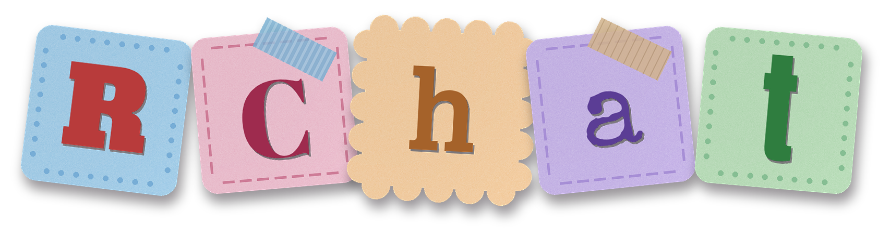
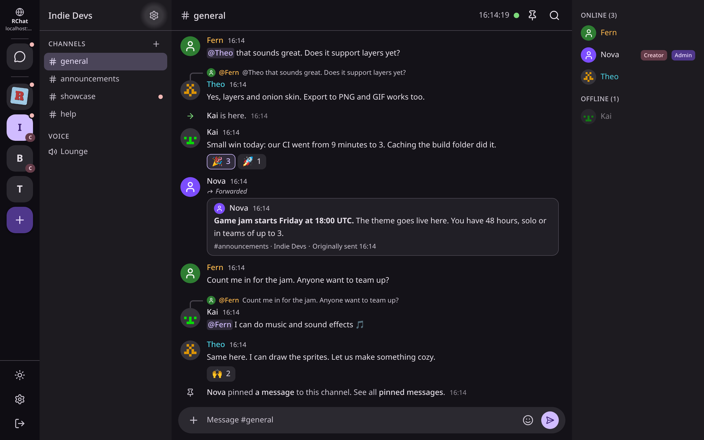

<p align="center">
  
</p>

<p align="center">
  <a href="https://github.com/RobbyV2/RChat/actions/workflows/ci.yml"></a>
  <a href="https://github.com/RobbyV2/RChat/pkgs/container/rchat"></a>
  
  
  
  
</p>

# RChat

RChat is a semi-anonymous chat app with a layout like Discord. It runs on your own machine. It uses no external services, no email and no tracking.

<p align="center">
  
</p>

Browsers: current Chrome, Edge and Firefox. Safari and iOS need version 16.4 or newer.

## Features

- Servers with text channels, voice channels, threads, categories and roles. Hosted server owners can delegate settings, invites, role editing and role assignment independently.
- Direct messages, friends and blocking
- Voice, video and screen share, in channels and in DMs
- P2P contacts, DMs, servers, calls and files, kept on the members' devices
- Replies, mentions, reactions, pins, forwarding, polls and link previews
- File uploads, instance-wide text-only mode, and text-only settings for individual channels. Links in text-only channels stay readable as text, and earlier messages keep their original content.
- Restricted channels, slow mode, server passwords and invite links
- Moderation, a profanity filter and a site admin panel
- Guests who read public servers without an account, and post or talk where the site and server allow it
- Chat and voice channels that other sites can embed, set up in Server Settings
- Sensitive channels that ask before they open, marked by a manager or on your own device
- Spoilers and hidden previews that show where you click them
- Accounts with no email or phone number
- Search, a command palette, notification settings and settings sync
- Dark and light themes, a PWA, and desktop and mobile apps
- Many instances, each with its own name and identity

## Setup

You need:

- Rust (stable)
- Bun 1.4 or newer
- [just](https://github.com/casey/just) 1.37 or newer

```bash
cp .env.local.example .env.local
just src install
just src dev
```

Open http://localhost:3000. The first account you register is the site admin.

`just --list src` shows every other command (tests, builds, formatting). The recipes are in `jfiles/`.

## Deployment

- From source: `just src prod` builds everything and serves it on `SERVER_PORT`.
- Docker: `docker run -p 3000:3000 -v rchat-data:/data ghcr.io/robbyv2/rchat:latest` (`latest` is the newest stable release, `weekly` the newest weekly build). `docker compose up` builds the image locally.
- Docker Compose with nginx, many copies: put hex passwords (`openssl rand -hex 24`) for `POSTGRES_PASSWORD` and `VALKEY_PASSWORD` in `deploy/.env`, then `docker compose -f deploy/compose.scale.yml up -d` (serves on port 8080).
- Kubernetes: copy `deploy/k8s/secrets.env.example` to `deploy/k8s/secrets.env` and fill it in, replace the `REPLACE` values in `deploy/k8s/config.yaml` and `chat.example.com` in `deploy/k8s/ingress.yaml`, then `kubectl apply -k deploy/k8s`.

Set the instance name, upload images and schedule announcements under Site administration → Branding. In `APP_MODE=full`, the server uses the brand for page titles, tab icons and the installable app's manifest.

Accounts from the command line, also while the server runs: `server user create <name>` makes an account with a temporary password (the first account is the site admin, also with sign-up closed), and `server user reset-password <name>` gives one a new temporary password. From source it is `cargo run --bin server -- user create <name>`, in Docker `docker exec <container> /app/server user create <name>`.

A proxy in front needs one domain on port 443. It sends every path to `SERVER_PORT` and passes the WebSocket upgrade for `/api/ws` and `/peerjs`.

For indexed channel search on Postgres, install `btree_gist` and `intarray` or allow the server to create them.

Never run an older release on a database that a newer release upgraded.

### Run only the app

```bash
just src build-client
```

Serve `apps/web/out/` on a static host that returns `index.html` for unknown paths. People choose the RChat instances they use when they open the app. To build and serve it locally, run `just src client`. Set `PORT` to choose a port (default 3000).

### Scaling

For more load, run many copies of the same image on one Postgres database and one Redis server, and give each copy its roles with `RCHAT_ROLES`. Set `REDIS_URL` on every copy and `PEERJS_BUILTIN=false`, and send `/peerjs` to one separate PeerJS server (`deploy/peer`). Both examples above do this. Upgrade all copies together. With `WS_SOCKETS_MAX` set, run the `gateway` role on copies of its own: a full copy answers `/api/ready` with 503.

Set Postgres `max_connections` above the sum of the application pools plus space for maintenance. Use S3 for uploads on larger installations. Site administration → Config shows this copy's database pools and index builds.

Set `DATABASE_REPLICA_URLS` on the copies serving searches and older pages. Provision each streaming replica with a replication slot, give it at least the primary's `max_connections`, and drop its slot when retiring it.

## Configuration

Settings live in `.env.local` or in the environment (`docker run -e NAME=value`). The scaled Compose example reads `RCHAT_*` values such as `RCHAT_PUBLIC_URL` from `deploy/.env`, and Kubernetes reads `deploy/k8s/config.yaml`. `.env.local.example` lists every setting with its default and range. These are the ones almost everyone sets:

| Variable               | Default     | What it does                                                                                                                        |
| ---------------------- | ----------- | ----------------------------------------------------------------------------------------------------------------------------------- |
| `APP_MODE`             | `full`      | `full` serves the API and the app. `api-only` serves only the API.                                                                  |
| `HOST`                 | `127.0.0.1` | The address the server listens on. Use `0.0.0.0` for remote access.                                                                 |
| `SERVER_PORT`          | `3000`      | The public port.                                                                                                                    |
| `DATABASE_URL`         | `rchat.db`  | A sqlite file, or a `postgres://` URL.                                                                                              |
| `PUBLIC_URL`           | none        | The address people open, for example `https://chat.example.com`.                                                                    |
| `INSTANCE_NAME`        | `RChat`     | The name people see for your instance.                                                                                              |
| `AUTH_REGISTRATION`    | `open`      | Who can sign up with a password: `open`, `sso` or `closed`. Closed before any account exists: make yours with `server user create`. |
| `FEATURE_FILE_UPLOADS` | `on`        | File uploads to this instance, `on` or `off`.                                                                                       |
| `UPLOAD_MAX_MIB`       | `25`        | The largest upload in MiB. Raise your proxy's body size limit to match.                                                             |
| `S3_ENDPOINT`          | none        | Stores uploads in an S3 bucket, with `S3_BUCKET`, `S3_ACCESS_KEY` and `S3_SECRET_KEY`.                                              |
| `TRUSTED_PROXIES`      | none        | Proxy addresses to trust for the real client address. Set it behind a proxy.                                                        |

Other instances accept this instance's identity assertions only when its public address uses port 443.

## Desktop and mobile apps

The desktop and mobile apps are client-only. On first launch, enter the address of your RChat instance.

Build the apps with `just src desktop-build` (installers in `target/release/bundle/`), `just src mobile-init android` then `just src android-build`, and `just src mobile-init ios` then `just src ios-sideload` (on a Mac). They need the [Tauri prerequisites](https://tauri.app/start/prerequisites/) for your platform.

## Releases

Stable releases and weekly pre-releases (`weekly-YYYY-MM-DD`, every Monday) are on [GitHub Releases](https://github.com/RobbyV2/RChat/releases). Each release has:

- Windows: `.msi` and `-setup.exe` installers.
- macOS 11 or newer: `RChat_<version>_universal.dmg`.
- Linux (glibc 2.35 or newer): `.deb` and `.AppImage`, plus `.rpm` in stable releases.
- Android 7.0 or newer: `RChat_<version>_android.apk`.
- iOS 16.4 or newer: an unsigned developer build, `RChat_<version>_ios_sideload.ipa`.
- The server: `rchat-server_<version>_<platform>` archives (the API alone, for `APP_MODE=api-only`) for Linux x86_64 and aarch64 (glibc 2.35 or newer), macOS and Windows x86_64, and the Docker image `ghcr.io/robbyv2/rchat`.
- `SHA256SUMS`.

## License

MIT. See [LICENSE](LICENSE).
